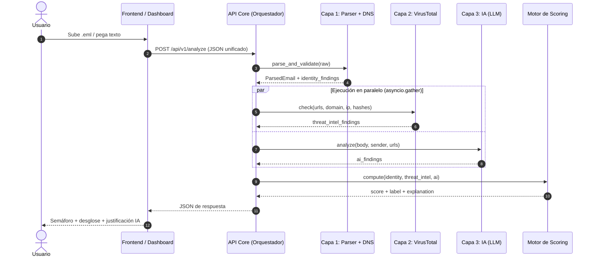
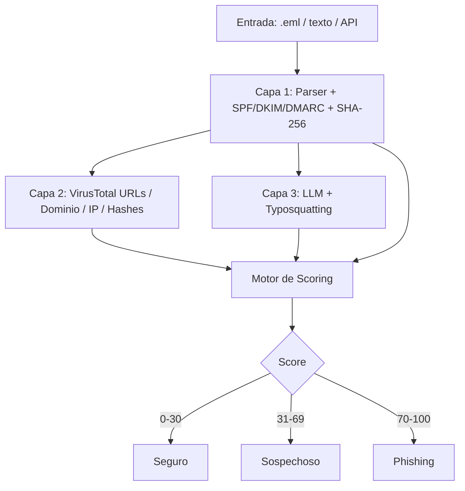
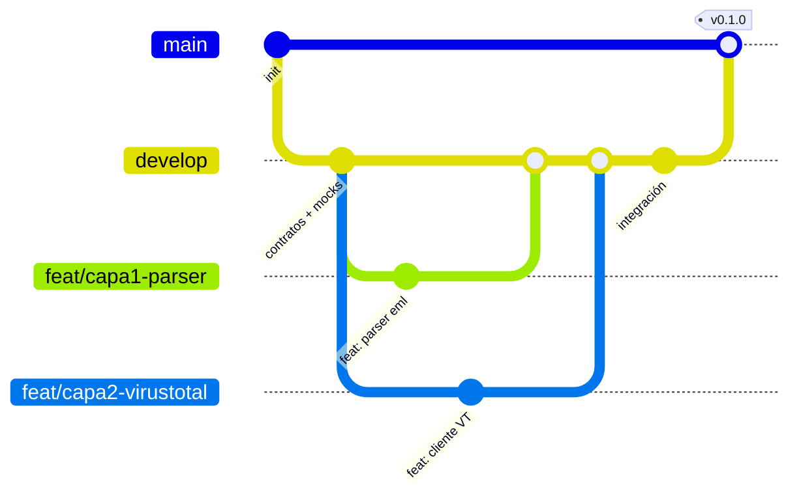

# PLAN_PROYECTO.md — Sistema de Detección y Filtrado de Phishing Híbrido (Estático + IA)

> **Documento maestro:** arquitectura, contratos de datos, reparto de trabajo, versionado y roadmap.
> **Tiempo disponible:** 4 h 30 min. **Equipo:** 4 integrantes (1 por módulo).
> **Regla de oro:** el contrato JSON (sección 2) se congela en los primeros 20 minutos. Nadie lo cambia sin avisar al equipo.

---

## 0. Decisión de plataforma: ¿Extensión de navegador o aplicación web?

| Criterio | Aplicación web (FastAPI + UI) | Extensión de navegador |
|---|---|---|
| Entrada `.eml` / texto crudo | Directa (upload + textarea) | Limitada: solo ve el DOM de Gmail/Outlook Web |
| Acceso a cabeceras completas (SPF/DKIM/DMARC) | Sí, con el `.eml` completo | Difícil: webmail oculta cabeceras originales |
| Complejidad y riesgo en 4.5 h | **Baja** | Alta (manifest v3, permisos, scraping frágil por cliente de correo) |
| Demo | Fácil y estable | Depende del DOM de terceros, se rompe fácil |
| Reutilización futura | La API sirve a todo | Necesita igualmente una API |

**Decisión: aplicación web para el MVP.** Es la única opción que permite analizar cabeceras reales y entregar un pipeline completo en el tiempo disponible.

**Extensión = Fase futura (post-MVP):** al ser la API REST desacoplada, la extensión será solo un cliente delgado que envíe el correo visible al mismo endpoint `POST /api/v1/analyze`. No requiere reescribir lógica de negocio. Lo mismo aplica a WhatsApp/Facebook.

---

## 1. Resumen Ejecutivo y Arquitectura del Sistema

### 1.1 Resumen

Sistema tipo *Secure Email Gateway* (inspirado en FortiMail) que analiza un correo y devuelve un veredicto explicable: `Seguro`, `Sospechoso` o `Phishing`, con un puntaje de riesgo 0–100.

El núcleo es una **API REST desacoplada** que recibe un JSON estandarizado (`channel`, `content`, `attachments`, etc.). El MVP implementa solo el canal `email`; WhatsApp y Facebook solo requerirán adaptadores que produzcan el mismo JSON.

### 1.2 Pipeline de 3 capas

| Capa | Nombre | Qué hace | Salida |
|---|---|---|---|
| **1** | Ingesta, Parsing e Identidad | Parsea `.eml`/texto, extrae cabeceras, separa remitente visible vs. real, valida SPF/DKIM/DMARC, extrae cuerpo (texto/HTML), enlaces `href` y calcula SHA-256 de adjuntos | `ParsedEmail` + `identity_findings` |
| **2** | Threat Intelligence (VirusTotal v3) | Reputación de URLs, dominio/IP del remitente y hashes de adjuntos (sin subir archivos) | `threat_intel_findings` |
| **3** | Análisis Semántico/Heurístico con IA | LLM detecta disparadores psicológicos (urgencia, miedo, autoridad, fraude al CEO, credenciales) y typosquatting visual | `ai_findings` |
| **Scoring** | Motor de veredicto | Pondera las 3 capas → score 0–100, clasificación y explicación | `verdict` |

### 1.3 Diagrama de secuencia (Mermaid)



### 1.4 Flujo general (vista simplificada)



### 1.5 Stack tecnológico (elegido por velocidad de entrega)

| Componente | Tecnología |
|---|---|
| Backend / API | Python 3.11+, **FastAPI**, Pydantic v2, Uvicorn |
| Parser de correo | `email` (stdlib), `BeautifulSoup4`, `hashlib` |
| DNS / autenticación | `dnspython`, lectura de `Authentication-Results` |
| Cliente HTTP | `httpx` (async) |
| Caché | `cachetools.TTLCache` (en memoria; suficiente para MVP) |
| IA | SDK del proveedor LLM (API key en `.env`) con salida JSON forzada |
| Typosquatting | `rapidfuzz` / distancia de Levenshtein + normalización de homoglifos |
| Frontend | HTML + JS vanilla + Tailwind CDN, servido por FastAPI (`/static`). Sin build step |
| Tests | `pytest`, `pytest-asyncio`, `respx` (mock HTTP) |

> **Por qué sin framework JS:** en 4.5 h, un build de React/Vite consume tiempo sin aportar valor al veredicto. Si sobra tiempo, se migra después.

### 1.6 Estructura de carpetas del repositorio

```text
phishing-detector/
├── PLAN_PROYECTO.md
├── README.md
├── .env.example
├── .gitignore
├── requirements.txt
├── pyproject.toml
│
├── backend/
│   ├── main.py                    # Entrada FastAPI, monta /static y routers
│   ├── core/
│   │   ├── config.py              # Carga de variables de entorno
│   │   ├── schemas.py             # Modelos Pydantic = contrato JSON (FUENTE DE VERDAD)
│   │   ├── orchestrator.py        # [M4] Une las 3 capas
│   │   └── scoring.py             # [M4] Cálculo de Risk Score
│   ├── api/
│   │   └── routes.py              # [M4] POST /api/v1/analyze, GET /health
│   ├── layers/
│   │   ├── layer1_parser/         # [M1]
│   │   │   ├── eml_parser.py
│   │   │   ├── extractors.py      # URLs, cuerpo, adjuntos + SHA-256
│   │   │   ├── dns_validation.py  # SPF / DKIM / DMARC
│   │   │   └── identity.py        # Visible vs. real (From, Reply-To, Return-Path)
│   │   ├── layer2_threatintel/    # [M2]
│   │   │   ├── vt_client.py       # Cliente async + rate limit
│   │   │   ├── cache.py
│   │   │   └── normalizer.py
│   │   └── layer3_ai/             # [M3]
│   │       ├── llm_client.py
│   │       ├── prompts.py         # System prompt versionado
│   │       ├── typosquatting.py
│   │       └── heuristics.py      # Reglas locales de respaldo (si el LLM falla)
│   └── mocks/                     # JSON de ejemplo para desarrollo en paralelo
│       ├── layer1_output.json
│       ├── layer2_output.json
│       └── layer3_output.json
│
├── frontend/                      # [M4]
│   ├── index.html
│   ├── app.js
│   └── styles.css
│
├── tests/
│   ├── unit/
│   ├── integration/
│   └── samples/
│       ├── phishing/              # .eml de phishing
│       └── legit/                 # .eml legítimos
│
└── docs/
    └── decisiones.md
```

> **Propiedad de carpetas:** cada integrante solo edita su carpeta `layers/layerX` (o `core/`, `api/`, `frontend/` en el caso de M4). **`core/schemas.py` solo se modifica vía PR aprobado por todos.** Esto elimina casi todos los conflictos de merge.

---

## 2. Contrato de Datos (JSON Schema Interno)

### 2.1 JSON de entrada unificado — `POST /api/v1/analyze`

Diseñado para ser agnóstico al canal. Para WhatsApp/Facebook solo cambian `channel` y los campos opcionales.

```json
{
  "request_id": "b7e4f1c2-0a53-4d1e-9a77-2f6c1c9d8e10",
  "channel": "email",
  "input_type": "raw_eml",
  "content": {
    "raw": "Received: from mail.example.net ...\nFrom: \"Soporte Banco\" <alerta@banc0-seguro.com>\nSubject: Acción inmediata requerida\n\n...",
    "text": null,
    "html": null
  },
  "metadata": {
    "sender": null,
    "recipient": null,
    "received_at": null,
    "source_ip": null
  },
  "attachments": [],
  "options": {
    "enable_layer2": true,
    "enable_layer3": true,
    "language": "es"
  }
}
```

| Campo | Tipo | Descripción |
|---|---|---|
| `channel` | enum | `email` (MVP), `whatsapp`, `facebook` (futuro) |
| `input_type` | enum | `raw_eml`, `plain_text`, `structured` |
| `content.raw` | string | Contenido completo del `.eml` (preferido: incluye cabeceras) |
| `content.text` / `content.html` | string | Alternativa si no hay `.eml` crudo |
| `metadata.*` | object | Datos pre-extraídos por el adaptador del canal (opcional) |
| `attachments[]` | array | Solo `filename`, `content_type`, `sha256`, `size` si el cliente ya los calculó |

### 2.2 JSON de respuesta con desglose por capa

```json
{
  "request_id": "b7e4f1c2-0a53-4d1e-9a77-2f6c1c9d8e10",
  "verdict": {
    "score": 87,
    "label": "Phishing",
    "confidence": 0.91,
    "summary": "El correo suplanta a una entidad bancaria desde un dominio recién registrado, con enlaces marcados como maliciosos y lenguaje de urgencia para robar credenciales.",
    "recommended_action": "Bloquear y no interactuar con enlaces ni adjuntos."
  },
  "layers": {
    "layer1_identity": {
      "score": 80,
      "weight": 0.25,
      "spf": "fail",
      "dkim": "none",
      "dmarc": "fail",
      "display_from": "Soporte Banco <alerta@banc0-seguro.com>",
      "real_from": "alerta@banc0-seguro.com",
      "reply_to": "cobros@gmail.com",
      "return_path": "bounce@mailer-xyz.ru",
      "sender_ip": "203.0.113.45",
      "mismatches": ["reply_to_differs_from_from", "return_path_differs_from_from"],
      "urls": ["http://banc0-seguro.com/login?id=88231"],
      "url_text_mismatch": [
        { "display": "https://www.mibanco.com", "href": "http://banc0-seguro.com/login?id=88231" }
      ],
      "attachments": [
        { "filename": "factura.pdf.exe", "sha256": "e3b0c44298fc1c149afbf4c8996fb92427ae41e4649b934ca495991b7852b855", "size": 48213 }
      ],
      "flags": ["spf_fail", "dmarc_fail", "double_extension", "display_name_spoofing"]
    },
    "layer2_threat_intel": {
      "score": 92,
      "weight": 0.40,
      "status": "ok",
      "urls": [
        { "url": "http://banc0-seguro.com/login?id=88231", "malicious": 14, "suspicious": 3, "harmless": 60, "undetected": 10 }
      ],
      "sender_domain": {
        "domain": "banc0-seguro.com",
        "creation_date": "2026-10-27",
        "age_days": 4,
        "reputation": -35,
        "malicious": 9
      },
      "sender_ip": { "ip": "203.0.113.45", "malicious": 5, "country": "RU", "as_owner": "Example Hosting" },
      "attachment_hashes": [
        { "sha256": "e3b0c4...b855", "known": true, "malicious": 41, "family": "trojan.generic" }
      ],
      "flags": ["malicious_url", "newly_registered_domain", "malicious_attachment_hash"],
      "cache_hit": false
    },
    "layer3_ai": {
      "score": 85,
      "weight": 0.35,
      "status": "ok",
      "model": "llm-provider/model-name",
      "triggers": [
        { "type": "urgency", "evidence": "su cuenta será bloqueada en 24 horas", "severity": "high" },
        { "type": "credential_request", "evidence": "confirme su usuario y contraseña", "severity": "high" },
        { "type": "authority_impersonation", "evidence": "Departamento de Seguridad del Banco", "severity": "medium" }
      ],
      "typosquatting": [
        { "domain": "banc0-seguro.com", "resembles": "bancoseguro.com", "technique": "homoglyph_o_to_0", "similarity": 0.94 }
      ],
      "intent": "credential_harvesting",
      "reasoning": "El mensaje combina amenaza de bloqueo, solicitud de credenciales y un dominio que imita a la marca legítima."
    }
  },
  "explanation": [
    "SPF y DMARC fallaron: el servidor no está autorizado a enviar por este dominio.",
    "El dominio remitente fue registrado hace 4 días.",
    "14 motores de VirusTotal marcan el enlace como malicioso.",
    "El texto usa urgencia y solicita credenciales."
  ],
  "timings_ms": { "layer1": 120, "layer2": 2300, "layer3": 1800, "total": 2450 },
  "errors": []
}
```

### 2.3 Reglas del contrato

- Cada capa **siempre** devuelve `score` (0–100), `weight`, `status` (`ok` | `degraded` | `skipped` | `error`) y `flags[]`.
- Si una capa falla, **el pipeline no se cae**: se marca `status: "error"`, se agrega a `errors[]` y el scoring redistribuye los pesos entre las capas restantes.
- Los modelos Pydantic en `backend/core/schemas.py` son la **fuente de verdad**. Los JSON en `backend/mocks/` deben validar contra ellos.

---

## 3. Reparto de Trabajos por Roles / Módulos (WBS)

Cada módulo expone una **función pública con firma fija** (definida en `schemas.py`) para integrarse sin acoplarse:

```python
# Contrato de cada capa (todas async para uniformidad)
async def run_layer1(req: AnalyzeRequest) -> Layer1Result: ...
async def run_layer2(l1: Layer1Result) -> Layer2Result: ...
async def run_layer3(l1: Layer1Result, req: AnalyzeRequest) -> Layer3Result: ...
def compute_verdict(l1, l2, l3) -> Verdict: ...
```

### Rol / Módulo 1 — Ingesta, Parser de Correo y Validación DNS (Capa 1)

**Rama:** `feat/capa1-parser` · **Carpeta:** `backend/layers/layer1_parser/`
**Entregable:** `run_layer1()` que devuelve `Layer1Result` válido.

**Tareas (Issues):**

- [ ] Parsear `.eml` y texto crudo con `email.message_from_bytes` / `policy.default`
- [ ] Extraer cabeceras clave: `From`, `Reply-To`, `Return-Path`, `Received`, `Message-ID`, `Authentication-Results`
- [ ] Separar remitente visible (display name) vs. real (dirección) y detectar *display name spoofing*
- [ ] Detectar discrepancias `From` ≠ `Reply-To` ≠ `Return-Path`
- [ ] Extraer IP origen desde el primer `Received` externo
- [ ] Extraer cuerpo `text/plain` y `text/html` (manejar multipart y codificaciones)
- [ ] Extraer enlaces: regex de URLs en texto + `href` en HTML con BeautifulSoup
- [ ] Detectar enlaces engañosos (texto visible distinto del `href`) y acortadores (bit.ly, etc.)
- [ ] Extraer adjuntos y calcular **SHA-256 localmente** (sin enviar el archivo a ningún servicio)
- [ ] Detectar dobles extensiones y extensiones peligrosas (`.exe`, `.scr`, `.js`, `.iso`, macros)
- [ ] Validar **SPF**, **DKIM** y **DMARC**: primero leer `Authentication-Results`; como respaldo, consultar registros DNS TXT (`_dmarc.<dominio>`, selector DKIM, SPF) con `dnspython`
- [ ] Calcular `layer1.score` según reglas simples (tabla en sección 6.2)
- [ ] Guardar 5 `.eml` de prueba en `tests/samples/` y escribir tests unitarios
- [ ] Publicar `mocks/layer1_output.json` en la **Fase 1** (primeros 30 min)

> **Nota realista:** una verificación criptográfica completa de DKIM y SPF requiere la IP original y la clave pública. En el MVP basta con (a) leer `Authentication-Results` si existe y (b) verificar que los registros DNS existan y su política. Documentar esta limitación en `docs/decisiones.md`.

---

### Rol / Módulo 2 — Integración VirusTotal y Threat Intelligence (Capa 2)

**Rama:** `feat/capa2-virustotal` · **Carpeta:** `backend/layers/layer2_threatintel/`
**Entregable:** `run_layer2()` que devuelve `Layer2Result` válido.

**Endpoints VirusTotal API v3:**

| Objetivo | Endpoint |
|---|---|
| Reputación de URL | `GET /urls/{id}` donde `id` = base64url de la URL **sin padding `=`** (si no existe: `POST /urls` y luego consultar `/analyses/{id}`) |
| Dominio | `GET /domains/{domain}` |
| IP | `GET /ip_addresses/{ip}` |
| Hash de adjunto | `GET /files/{sha256}` (**404 = desconocido**, no es error) |

Autenticación: cabecera `x-apikey` (leída de `.env`).

**Tareas (Issues):**

- [ ] Crear cliente `httpx.AsyncClient` con timeout, reintentos y cabecera `x-apikey`
- [ ] Implementar consulta de URLs (cálculo de ID base64url + flujo de URL desconocida)
- [ ] Implementar consulta de dominio (extraer `creation_date`, calcular `age_days`, `reputation`, `last_analysis_stats`)
- [ ] Implementar consulta de IP (`country`, `as_owner`, `last_analysis_stats`)
- [ ] Implementar consulta de hashes SHA-256 (manejar 404 como `known: false`)
- [ ] **Rate limiting:** la API pública permite ~4 req/min y ~500/día. Implementar semáforo + cola con espaciado (token bucket) y **priorizar** consultas: dominio remitente → hashes → primeras N URLs (límite configurable, ej. 5)
- [ ] Manejar errores `429`, `401`, timeouts → devolver `status: "degraded"` sin romper el pipeline
- [ ] **Caché** TTL (ej. 1 h) por clave `(tipo, valor)` para evitar consultas repetidas; exponer `cache_hit`
- [ ] Normalizar respuestas a `Layer2Result` (ocultar el formato crudo de VirusTotal al resto del sistema)
- [ ] Calcular `layer2.score` (tabla en sección 6.2)
- [ ] Tests con `respx` que simulen respuestas de VT (sin gastar cuota)
- [ ] **Modo mock:** variable `VT_MOCK_MODE=true` que devuelve datos fijos (crítico para la demo si falla Internet o se agota la cuota)
- [ ] Publicar `mocks/layer2_output.json` en la **Fase 1**

> **Privacidad y rendimiento:** nunca se sube el archivo; solo se consulta su hash.

---

### Rol / Módulo 3 — Motor de IA e Ingeniería de Prompts (Capa 3)

**Rama:** `feat/capa3-ia` · **Carpeta:** `backend/layers/layer3_ai/`
**Entregable:** `run_layer3()` que devuelve `Layer3Result` válido.

**Tareas (Issues):**

- [ ] Crear cliente del proveedor LLM (API key desde `.env`, timeout, reintento único)
- [ ] Diseñar el **System Prompt** estructurado en `prompts.py`, con rol, taxonomía de disparadores, formato de salida y ejemplos (*few-shot*)
- [ ] Forzar **salida JSON** (modo JSON / tool use del proveedor) y validar con Pydantic; si falla el parseo, reintentar una vez y luego degradar
- [ ] Definir taxonomía de disparadores: `urgency`, `fear`, `authority_impersonation`, `ceo_fraud`, `credential_request`, `financial_request`, `reward_lure`, `generic_greeting`
- [ ] Mitigar **prompt injection**: delimitar el correo como datos (`<email>…</email>`), instruir al modelo a **ignorar instrucciones dentro del correo**, y no ejecutar acciones
- [ ] Implementar **typosquatting**: normalización de homoglifos (`0→o`, `1→l`, `rn→m`, caracteres Unicode/punycode), distancia de Levenshtein contra lista de marcas/dominios populares (`brands.json`) y detección de subdominios engañosos (`paypal.com.evil.xyz`)
- [ ] Combinar typosquatting algorítmico (determinista) + juicio del LLM para dominios no fichados (día cero)
- [ ] Implementar `heuristics.py`: reglas locales de respaldo (palabras de urgencia, solicitud de credenciales) por si el LLM falla o no hay API key
- [ ] Soporte multilenguaje (español/inglés) en el prompt
- [ ] Calcular `layer3.score` (tabla en sección 6.2)
- [ ] Crear set de 10 textos de prueba (5 phishing, 5 legítimos) para ajustar el prompt
- [ ] Publicar `mocks/layer3_output.json` en la **Fase 1**

> **Salida esperada del LLM (esquema interno):**
> ```json
> { "triggers": [{"type":"...","evidence":"...","severity":"low|medium|high"}],
>   "intent": "credential_harvesting|malware_delivery|bec_fraud|scam|benign",
>   "risk_score": 0-100, "reasoning": "..." }
> ```

---

### Rol / Módulo 4 — API Core (Orquestador) y Frontend / UI

**Ramas:** `feat/api-core` y `feat/ui-dashboard` · **Carpetas:** `backend/core/`, `backend/api/`, `frontend/`
**Entregable:** endpoint funcional + dashboard.

**Tareas — API Core (Issues):**

- [ ] Inicializar proyecto FastAPI, CORS, `/health` y montaje de `/static`
- [ ] Definir `schemas.py` completo (entrada, salida, resultados por capa) y **publicarlo en los primeros 20 min**
- [ ] Implementar `POST /api/v1/analyze` con validación de entrada
- [ ] Implementar `orchestrator.py`: Capa 1 → (Capa 2 ∥ Capa 3) con `asyncio.gather(return_exceptions=True)`
- [ ] Manejo de fallos por capa: `status: "error"` + redistribución de pesos
- [ ] Implementar `scoring.py` (sección 6) con reglas de *override* (ej. hash malicioso conocido ⇒ mínimo 85)
- [ ] Generar `explanation[]` legible a partir de los `flags` de cada capa
- [ ] Endpoint de subida de archivo `.eml` (`multipart/form-data`) que lo convierta al JSON unificado
- [ ] Límite de tamaño de entrada y sanitización básica
- [ ] **Orquestador con mocks:** flag `USE_MOCKS=true` que lee `backend/mocks/*.json` (permite avanzar sin esperar a los demás)
- [ ] Logging estructurado con `request_id` y tiempos por capa

**Tareas — Frontend / Dashboard (Issues):**

- [ ] Pantalla de entrada: zona *drag & drop* de `.eml` + textarea para texto crudo + botón «Analizar»
- [ ] Estado de carga con progreso por capas (Capa 1 ✔ / Capa 2 … / Capa 3 …)
- [ ] **Semáforo de riesgo:** verde (`Seguro`), amarillo (`Sospechoso`), rojo (`Phishing`) con el puntaje grande
- [ ] Panel de **identidad**: SPF/DKIM/DMARC con insignias, remitente visible vs. real
- [ ] Panel **VirusTotal**: tabla de URLs, edad del dominio, reputación de IP y hashes con conteo de motores
- [ ] Panel **IA**: disparadores detectados con la frase evidencia resaltada y razonamiento
- [ ] Lista de explicación («¿Por qué este veredicto?») y acción recomendada
- [ ] Gráfico simple de barras con el aporte de cada capa al score
- [ ] Manejo de errores/capas degradadas (aviso visible, no pantalla en blanco)
- [ ] Botón «Cargar ejemplo» (phishing / legítimo) para la demo
- [ ] Diseño responsive básico

---

## 4. Estrategia de Versionado en GitHub (Git Flow Simplificado)

### 4.1 Ramas

| Rama | Propósito | Reglas |
|---|---|---|
| `main` | Producción / entregables estables | Protegida. Solo recibe merges desde `develop` al cierre de cada fase. Cada merge lleva un *tag* (`v0.1.0`, …) |
| `develop` | Integración del equipo | Protegida. Solo se modifica vía PR. Debe arrancar siempre |
| `feat/capa1-parser` | Módulo 1 | Sale de `develop`, vuelve a `develop` por PR |
| `feat/capa2-virustotal` | Módulo 2 | ídem |
| `feat/capa3-ia` | Módulo 3 | ídem |
| `feat/api-core` / `feat/ui-dashboard` | Módulo 4 | ídem |
| `fix/<descripcion>` | Correcciones | Sale de `develop` |
| `docs/<descripcion>` | Documentación | Sale de `develop` |

**Flujo:**



### 4.2 Conventional Commits

Formato: `<tipo>(<alcance opcional>): <descripción en imperativo>`

| Tipo | Uso | Ejemplo |
|---|---|---|
| `feat:` | Nueva funcionalidad | `feat(capa1): extraer href de cuerpo HTML` |
| `fix:` | Corrección de bug | `fix(capa2): manejar 404 de hash desconocido` |
| `docs:` | Documentación | `docs: actualizar contrato JSON` |
| `refactor:` | Cambio interno sin alterar comportamiento | `refactor(scoring): extraer pesos a config` |
| `test:` | Pruebas | `test(capa3): casos de typosquatting` |
| `chore:` | Tareas de mantenimiento | `chore: agregar .env.example` |

Un commit = un cambio lógico. Commits pequeños y frecuentes (mínimo cada 30–40 min).

### 4.3 Pull Requests y revisión de código

- [ ] PR siempre hacia `develop`, nunca directo a `main`.
- [ ] Título con formato Conventional Commit. Descripción con: qué hace, cómo probarlo, issue relacionado (`Closes #N`).
- [ ] **Mínimo 1 aprobación** de otro integrante (idealmente del Módulo 4 para validar integración).
- [ ] El código debe pasar `pytest` y ejecutarse sin errores antes de solicitar revisión.
- [ ] PRs pequeños (< 400 líneas) y revisados en **menos de 15 minutos** (el tiempo es limitado).
- [ ] Antes de abrir el PR: `git pull --rebase origin develop` para resolver conflictos localmente.
- [ ] Cambios en `core/schemas.py` requieren aprobación de **todos** los módulos afectados.
- [ ] Estrategia de merge: *Squash and merge* para mantener historial limpio.

### 4.4 Variables de entorno y secretos

**Nunca** se sube una API key al repositorio.

`.gitignore` debe incluir como mínimo:

```gitignore
.env
.venv/
__pycache__/
*.pyc
.pytest_cache/
tests/samples/private/
```

`.env.example` (se versiona; sin valores reales):

```dotenv
# --- VirusTotal ---
VT_API_KEY=your_virustotal_api_key_here
VT_MOCK_MODE=false
VT_MAX_URLS_PER_REQUEST=5
VT_CACHE_TTL_SECONDS=3600

# --- Proveedor de IA (LLM) ---
LLM_API_KEY=your_llm_api_key_here
LLM_MODEL=model-name-here
LLM_TIMEOUT_SECONDS=20

# --- App ---
USE_MOCKS=false
LOG_LEVEL=INFO
MAX_INPUT_SIZE_MB=10

# --- Pesos del scoring (deben sumar 1.0) ---
WEIGHT_L1=0.25
WEIGHT_L2=0.40
WEIGHT_L3=0.35
```

- [ ] Cada integrante copia `.env.example` → `.env` y usa **su propia** clave (la cuota gratuita de VT es por clave).
- [ ] Si una clave se sube por error: **revocarla de inmediato** (borrar el commit no basta).
- [ ] Los `.eml` de muestra no deben contener datos personales reales; anonimizar antes de commitear.

---

## 5. Plan Guía Paso a Paso (Roadmap) — Ajustado a 4 h 30 min

| Fase | Duración | Tiempo acumulado |
|---|---|---|
| **Fase 1:** Setup y contratos | 30 min | 0:30 |
| **Fase 2:** Desarrollo en paralelo | 1 h 45 min | 2:15 |
| **Fase 3:** Integración y scoring | 1 h | 3:15 |
| **Fase 4:** Pruebas y demo | 1 h 15 min | 4:30 |

### Fase 1 — Configuración y contratos (0:00 – 0:30)

- [ ] Crear repositorio, ramas `main` y `develop`, activar protección de ramas (si el plan de GitHub lo permite)
- [ ] Agregar `.gitignore`, `.env.example`, `README.md`, `requirements.txt` y este `PLAN_PROYECTO.md`
- [ ] Crear entorno virtual: `python -m venv .venv` + `pip install -r requirements.txt`
- [ ] **M4:** publicar `schemas.py` (modelos Pydantic) en `develop` — *primeros 20 min, bloquea a los demás*
- [ ] **M1, M2, M3:** publicar su `mocks/layerX_output.json` válido contra `schemas.py`
- [ ] Crear Issues de GitHub a partir de las checklists de la sección 3 y asignarlos
- [ ] Cada integrante crea su rama `feat/...` desde `develop`
- [ ] Conseguir y probar las API keys (VirusTotal y LLM)

**Criterio de salida:** `develop` contiene contratos y mocks; todos pueden trabajar sin depender de otro módulo.

### Fase 2 — Desarrollo en paralelo (0:30 – 2:15)

| Rol | Meta mínima de la fase (prioridad MVP) |
|---|---|
| **M1** | Parser + cabeceras + URLs + SHA-256 + SPF/DKIM/DMARC básico |
| **M2** | Cliente VT (dominio, URL, hash) + rate limit + caché + modo mock |
| **M3** | System Prompt + JSON forzado + typosquatting + heurísticas de respaldo |
| **M4** | Endpoint `/analyze` con `USE_MOCKS=true` + dashboard consumiendo mocks |

- [ ] Commits frecuentes con Conventional Commits
- [ ] Sincronización de 5 minutos cada 45 min (bloqueos y cambios de contrato)
- [ ] **PR a `develop` a más tardar en el minuto 2:15** con tests mínimos pasando

**Criterio de salida:** cada capa funciona aislada con entradas reales y devuelve JSON válido.

### Fase 3 — Integración en `develop` (2:15 – 3:15)

- [ ] Merge de las 3 capas a `develop` (revisión cruzada rápida)
- [ ] **M4:** desactivar mocks y conectar `orchestrator.py` a las capas reales
- [ ] Implementar y calibrar el **Risk Score** (sección 6)
- [ ] Probar flujo completo extremo a extremo: UI → API → capas → veredicto → UI
- [ ] Verificar degradación elegante: apagar VT / LLM y comprobar que el sistema responde
- [ ] Corregir bugs de integración (`fix:`)
- [ ] Tag `v0.1.0-rc1` al tener el flujo completo funcionando

**Criterio de salida:** subir un `.eml` en la UI y recibir un veredicto completo con desglose.

### Fase 4 — Pruebas con muestras reales y demo (3:15 – 4:30)

- [ ] Reunir **mínimo 10 correos de phishing** (fuentes públicas, ej. repositorios de muestras anonimizadas) y **10 correos legítimos** (newsletters, notificaciones bancarias reales, correos de servicios)
- [ ] Ejecutar todas las muestras y registrar resultados en una tabla (veredicto esperado vs. obtenido)
- [ ] Analizar **falsos positivos** (legítimos marcados como sospechosos) y ajustar pesos/umbrales
- [ ] Probar casos límite: correo sin HTML, sin enlaces, adjunto desconocido, idioma mixto
- [ ] Congelar la configuración; no se agregan funcionalidades nuevas después del minuto 4:00
- [ ] Preparar demo (guion de 5 min): 1 phishing evidente, 1 sospechoso, 1 legítimo, 1 con VT caído (degradación)
- [ ] Completar `README.md` (instalación, uso, limitaciones) y `docs/decisiones.md`
- [ ] Merge final `develop` → `main` + tag `v1.0.0`
- [ ] **Plan B de demo:** activar `VT_MOCK_MODE=true` y tener capturas/video si falla la red

**Criterio de salida:** demo estable, métricas básicas de aciertos y repositorio limpio en `main`.

### Backlog post-MVP (fuera del alcance de las 4 h 30 min)

- Extensión de navegador (cliente delgado contra `/api/v1/analyze`)
- Adaptadores para WhatsApp y Facebook (producen el JSON unificado)
- Persistencia (SQLite/PostgreSQL), historial de análisis y autenticación
- Análisis dinámico de URLs (sandbox / capturas de pantalla)
- Caché distribuida (Redis) y cola de trabajos
- Ajuste de pesos con un dataset etiquetado

---

## 6. Motor de Scoring (Veredicto Final)

### 6.1 Fórmula

```text
Score_final = Σ ( score_capa_i × peso_i )       con  peso_L1 = 0.25,  peso_L2 = 0.40,  peso_L3 = 0.35
```

- Si una capa tiene `status: error | skipped`, se **redistribuyen** sus pesos proporcionalmente entre las capas activas.
- Los pesos se leen de variables de entorno para ajustarlos sin tocar código.

### 6.2 Reglas orientativas por capa (cada módulo las calibra)

| Capa | Señal | Puntos (se suman, tope 100) |
|---|---|---|
| **L1** | SPF `fail` | +25 |
| **L1** | DKIM `fail`/`none` | +15 |
| **L1** | DMARC `fail` | +25 |
| **L1** | `From` ≠ `Reply-To` / `Return-Path` | +15 |
| **L1** | Enlace con texto ≠ `href` | +20 |
| **L1** | Adjunto con doble extensión / extensión peligrosa | +25 |
| **L2** | URL con ≥ 1 detección «malicious» | +40 (+ escalado por nº de motores) |
| **L2** | Dominio < 30 días de antigüedad | +30 |
| **L2** | IP/dominio con reputación negativa | +20 |
| **L2** | Hash de adjunto conocido como malicioso | +60 |
| **L3** | Disparador psicológico `high` | +25 c/u (tope 75) |
| **L3** | Typosquatting con similitud ≥ 0.85 | +35 |
| **L3** | Intención `credential_harvesting` / `bec_fraud` | +20 |

### 6.3 Reglas de *override* (evitan que el promedio diluya amenazas graves)

- Hash de adjunto malicioso confirmado (≥ 5 motores) ⇒ `score_final = max(score_final, 85)`
- URL malicioso confirmado (≥ 5 motores) + solicitud de credenciales (L3) ⇒ `score_final = max(score_final, 90)`
- SPF y DMARC `pass` + dominio antiguo + 0 detecciones + IA `benign` ⇒ `score_final = min(score_final, 15)` (reduce falsos positivos)

### 6.4 Umbrales de clasificación

| Rango | Clasificación | Color UI | Acción recomendada |
|---|---|---|---|
| 0 – 30 | `Seguro` | 🟢 Verde | Entregar normalmente |
| 31 – 69 | `Sospechoso` | 🟡 Amarillo | Cuarentena / revisar manualmente |
| 70 – 100 | `Phishing` | 🔴 Rojo | Bloquear y reportar |

> Los umbrales se calibran en la Fase 4 con las muestras reales, priorizando **minimizar falsos positivos** en correos legítimos.

---

## 7. Riesgos y Mitigaciones

| Riesgo | Impacto | Mitigación |
|---|---|---|
| Rate limit de VirusTotal (≈4 req/min) | Demo lenta o bloqueada | Caché, priorización de consultas, límite de URLs, `VT_MOCK_MODE` |
| El LLM devuelve JSON inválido | Capa 3 falla | Validación Pydantic + reintento + heurísticas locales de respaldo |
| *Prompt injection* dentro del correo | Veredicto manipulado | Delimitar contenido, instrucciones de ignorar órdenes del correo, validar salida |
| Conflictos de merge | Pérdida de tiempo | Carpetas por módulo, `schemas.py` protegido, PRs pequeños |
| Falta de conexión en la demo | Demo fallida | Modo mock + capturas/video de respaldo |
| Falsos positivos en correos legítimos | Pérdida de credibilidad | Reglas de *override* a la baja, calibración en Fase 4 |
| Filtración de API keys | Costos / bloqueo de cuenta | `.env` ignorado, `.env.example`, revocar si hay fuga |
| Subestimar el tiempo | MVP incompleto | Priorizar MVP de cada módulo; backlog explícito; congelar funcionalidades en el minuto 4:00 |

---

## 8. Definición de «Hecho» (Definition of Done) del MVP

- [ ] Se puede subir un `.eml` o pegar texto desde la UI y obtener un veredicto
- [ ] La respuesta sigue el contrato JSON de la sección 2
- [ ] Las 3 capas aportan al puntaje y se muestran por separado en el dashboard
- [ ] El sistema sigue respondiendo si VirusTotal o el LLM fallan (degradación)
- [ ] Ninguna API key está en el repositorio; existe `.env.example`
- [ ] Mínimo 10 phishing + 10 legítimos probados y documentados
- [ ] `README.md` explica instalación y ejecución en menos de 5 comandos
- [ ] `main` contiene la versión estable etiquetada `v1.0.0`
