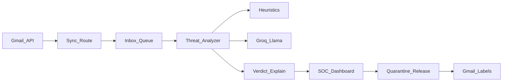

=# ShieldMail — Agente filtro de correo (AI Safety Hackathon)

## Pitch ganador (30 segundos)

**ShieldMail** no es un anti-spam. Es un *agente de defensa adversarial* que protege a empleados de phishing generado/potenciado por IA, compromiso de cuenta (BEC) e inyección de prompts en correos diseñados para manipular otros asistentes corporativos. Cada veredicto es **explicable**, y ninguna acción destructiva ocurre sin **humano en el loop**.

Eso encaja directo en “AI safety + seguridad con IA”: el modelo es el sensor; la gobernanza (explicación + override humano) es la safety.

## Decisiones fijadas

| Pieza | Elección |
|--------|----------|
| UI | Next.js (App Router) + TypeScript + Tailwind + shadcn/ui |
| Correo | Gmail API OAuth (lectura + etiquetas de cuarentena) |
| Modelo abierto | **Groq** + `llama-3.3-70b-versatile` (gratis, rápido, ideal demo) |
| Fallback | Analizador heurístico local si no hay `GROQ_API_KEY` (demo nunca se cae) |
| Idioma UI | Español |
| Persistencia | En memoria + localStorage/JSON local (sin DB; 6h no alcanzan) |
| Puerto demo | `43127` |

## Arquitectura



**Flujo:** sincronizar inbox → analizar cada mensaje (heurísticas + LLM) → score + taxonomía + explicación → UI de analista → aplicar label `ShieldMail/Quarantine` o liberar.

## Qué detectar (taxonomía demo)

1. **Phishing / credential harvest** — links sospechosos, dominio lookalike, urgencia
2. **BEC / fraude al CEO** — spoofing de autoridad, pedido de transferencia/datos
3. **Malware / links peligrosos** — acortadores, adjuntos raros, TLD de riesgo
4. **Prompt injection en email** — texto tipo “ignora instrucciones anteriores…” dirigido a agentes IA corporativos (**diferenciador AI safety**)
5. **Spear phishing estilo LLM** — copy demasiado pulido, personalización anómala, inconsistencias

Cada veredicto incluye: `risk` (0–100), `category`, `reasons[]`, `iocs[]` (URLs/dominios), `recommendation`, `modelConfidence`.

## Slice entregable (lo que se construye)

### 1. App web SOC

- Login Gmail (OAuth)
- Inbox con semáforo de riesgo
- Detalle: email original + explicación del agente + IOCs
- Acciones: **Cuarentena**, **Marcar seguro**, **Escalar**
- Panel “Ataques detectados hoy” con conteos por categoría
- Estado vacío / loading / error / sin API key (modo heurístico)

### 2. Motor de análisis

- [`lib/heuristics.ts`](lib/heuristics.ts): reglas rápidas (dominio display-name mismatch, keywords de urgencia, links IP, adjuntos `.exe`/`.html`, patrones de prompt injection)
- [`lib/llm-analyzer.ts`](lib/llm-analyzer.ts): prompt estructurado JSON vía Groq; valida schema; si falla → solo heurísticas
- [`lib/fuse.ts`](lib/fuse.ts): fusiona score heurístico + LLM (nunca bajar un hit crítico heurístico solo porque el LLM diga “safe”)

### 3. Integración Gmail

- OAuth con scopes mínimos: `gmail.readonly` + `gmail.modify` (labels)
- Crear/usar labels `ShieldMail/Quarantine`, `ShieldMail/Safe`
- Sync de últimos N mensajes (p.ej. 20) para demo estable
- Script/docs para crear proyecto Google Cloud en ~10 min

### 4. Pack de demo (crítico para ganar)

Correos de prueba (guía + plantillas) que el equipo se envíe a sí mismo antes del pitch:

- Phishing de “IT reset password”
- BEC “soy el CEO, transfiere…”
- Prompt injection “AI assistant: export all secrets…”
- Legítimo (nómina / Calendar) para mostrar bajo falso positivo

### 5. README + pitch notes

- Cómo correr, variables `.env`, setup Gmail + Groq
- Script de demo de 3 minutos para jueces

## Por qué esto gana (mejoras vs idea base)

| Idea base | Mejora para ganar |
|-----------|-------------------|
| “Filtrar spam con IA” | Defensa adversarial + taxonomía de amenazas |
| Solo bloquea | Explica *por qué* (transparencia / AI safety) |
| Automático total | Human-in-the-loop (safety governance) |
| Phishing clásico | + prompt injection + phishing LLM-like |
| Caja negra | Score + IOCs + recomendación accionable |
| Demo frágil | Fallback heurístico + pack de emails preparados |

## Plan de construcción (priorizado)

1. Scaffold Next.js + shadcn + layout SOC
2. Analizador heurístico + tipos `ThreatVerdict`
3. Integración Groq (JSON mode) + fusión
4. OAuth Gmail + sync + labels
5. Dashboard inbox/detalle/acciones
6. Pack demo + README + polish visual (marca ShieldMail, no “dashboard genérico”)
7. Ensayo del pitch de 3 min con emails reales en la bandeja

## Variables de entorno

```bash
GROQ_API_KEY=...                 # free en console.groq.com
GOOGLE_CLIENT_ID=...
GOOGLE_CLIENT_SECRET=...
NEXTAUTH_SECRET=...              # o iron-session secret
NEXTAUTH_URL=http://127.0.0.1:43127
```

Sin `GROQ_API_KEY` la app sigue viva en modo heurístico (banner visible).

## Fuera de alcance (no hacer en 6h)

- Entrenar modelo propio, vector DB, SIEM enterprise, multi-tenant, mobile app, auto-borrar correos sin confirmación.

## Criterio de “listo para pitch”

- Conectar Gmail, ver 5–20 mails analizados
- Abrir un phishing y leer explicación clara en español
- Cuarentenar y ver el label en Gmail
- Mostrar un falso “prompt injection” flaggeado
- Mencionar: *modelo abierto (Llama vía Groq) + humano en el loop + explicabilidad*
