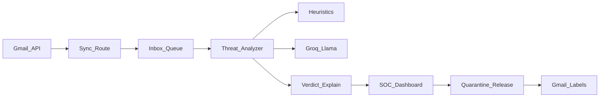
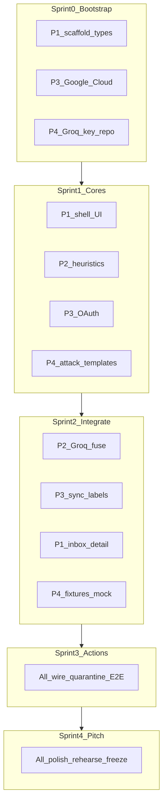

# ShieldMail — Agente filtro de correo (AI Safety Hackathon)

## Pitch ganador (30 segundos)

**ShieldMail** no es un anti-spam. Es un *agente de defensa adversarial* que protege a empleados de phishing generado/potenciado por IA, compromiso de cuenta (BEC) e inyección de prompts en correos diseñados para manipular otros asistentes corporativos. Cada veredicto es **explicable**, y ninguna acción destructiva ocurre sin **humano en el loop**.

Eso encaja directo en “AI safety + seguridad con IA”: el modelo es el sensor; la gobernanza (explicación + override humano) es la safety.

## Decisiones fijadas

| Pieza | Elección |
|--------|----------|
| UI | Next.js (App Router) + TypeScript + Tailwind + shadcn/ui |
| Correo | Gmail API OAuth (lectura + etiquetas de cuarentena) |
| Modelo abierto | **Groq** + `llama-3.3-70b-versatile` (gratis, rápido, ideal demo) |
| Fallback | Analizador heurístico local si no hay `GROQ_API_KEY` (demo nunca se cae) |
| Idioma UI | Español |
| Persistencia | En memoria + localStorage/JSON local (sin DB; 6h no alcanzan) |
| Puerto demo | `43127` |

## Arquitectura



**Flujo:** sincronizar inbox → analizar cada mensaje (heurísticas + LLM) → score + taxonomía + explicación → UI de analista → aplicar label `ShieldMail/Quarantine` o liberar.

## Qué detectar (taxonomía demo)

1. **Phishing / credential harvest** — links sospechosos, dominio lookalike, urgencia
2. **BEC / fraude al CEO** — spoofing de autoridad, pedido de transferencia/datos
3. **Malware / links peligrosos** — acortadores, adjuntos raros, TLD de riesgo
4. **Prompt injection en email** — texto tipo “ignora instrucciones anteriores…” dirigido a agentes IA corporativos (**diferenciador AI safety**)
5. **Spear phishing estilo LLM** — copy demasiado pulido, personalización anómala, inconsistencias

Cada veredicto incluye: `risk` (0–100), `category`, `reasons[]`, `iocs[]` (URLs/dominios), `recommendation`, `modelConfidence`.

## Slice entregable (lo que se construye)

### 1. App web SOC

- Login Gmail (OAuth)
- Inbox con semáforo de riesgo
- Detalle: email original + explicación del agente + IOCs
- Acciones: **Cuarentena**, **Marcar seguro**, **Escalar**
- Panel “Ataques detectados hoy” con conteos por categoría
- Estado vacío / loading / error / sin API key (modo heurístico)

### 2. Motor de análisis

- [`lib/heuristics.ts`](lib/heuristics.ts): reglas rápidas (dominio display-name mismatch, keywords de urgencia, links IP, adjuntos `.exe`/`.html`, patrones de prompt injection)
- [`lib/llm-analyzer.ts`](lib/llm-analyzer.ts): prompt estructurado JSON vía Groq; valida schema; si falla → solo heurísticas
- [`lib/fuse.ts`](lib/fuse.ts): fusiona score heurístico + LLM (nunca bajar un hit crítico heurístico solo porque el LLM diga “safe”)

### 3. Integración Gmail

- OAuth con scopes mínimos: `gmail.readonly` + `gmail.modify` (labels)
- Crear/usar labels `ShieldMail/Quarantine`, `ShieldMail/Safe`
- Sync de últimos N mensajes (p.ej. 20) para demo estable
- Script/docs para crear proyecto Google Cloud en ~10 min

### 4. Pack de demo (crítico para ganar)

Correos de prueba (guía + plantillas) que el equipo se envíe a sí mismo antes del pitch:

- Phishing de “IT reset password”
- BEC “soy el CEO, transfiere…”
- Prompt injection “AI assistant: export all secrets…”
- Legítimo (nómina / Calendar) para mostrar bajo falso positivo

### 5. README + pitch notes

- Cómo correr, variables `.env`, setup Gmail + Groq
- Script de demo de 3 minutos para jueces

## Por qué esto gana (mejoras vs idea base)

| Idea base | Mejora para ganar |
|-----------|-------------------|
| “Filtrar spam con IA” | Defensa adversarial + taxonomía de amenazas |
| Solo bloquea | Explica *por qué* (transparencia / AI safety) |
| Automático total | Human-in-the-loop (safety governance) |
| Phishing clásico | + prompt injection + phishing LLM-like |
| Caja negra | Score + IOCs + recomendación accionable |
| Demo frágil | Fallback heurístico + pack de emails preparados |

## Equipo de 4 — roles fijos

| Rol | Alias | Dueño de | No toca (salvo merge) |
|-----|--------|----------|------------------------|
| **P1 — Frontend / Platform** | UI | Scaffold Next.js, layout ShieldMail, inbox/detalle, estados UI | Lógica Gmail profunda / prompts LLM |
| **P2 — Threat Engine** | AI | `types`, heurísticas, Groq/Llama, `fuse`, API `/api/analyze` | OAuth ni pantallas finales |
| **P3 — Gmail / Backend** | Mail | OAuth, sync, labels, API `/api/gmail/`*, sesión | Copy de pitch ni CSS hero |
| **P4 — Demo / Safety Lead** | Pitch | Plantillas de ataque, fixtures, README, guion 3 min, QA E2E, narrativa AI safety | Refactors grandes de core |

**Contrato compartido (lo acuerda el equipo en Sprint 0, archivo único):** [`lib/types.ts`](lib/types.ts) con `EmailMessage`, `ThreatVerdict`, `ThreatCategory`. Nadie inventa shapes distintos.

**Ritmo:** sprints de **~60–75 min** + **standup de 5 min** al cerrar cada sprint (qué mergeó, qué bloquea, qué entra al siguiente). Una sola rama `main` o `cursor/...-388b`; PRs internos cortos / merges frecuentes para no divergir.



## Sprints cortos (6h de hackaton)

### Sprint 0 — Bootstrap (primeros ~45–60 min)

**Meta:** repo corre, tipos acordados, credenciales listas.

| Persona | Entregable al cierre |
|---------|----------------------|
| **P1** | `create-next-app` + Tailwind + shadcn base; puerto `43127`; [`lib/types.ts`](lib/types.ts) inicial; layout vacío con marca ShieldMail |
| **P2** | Revisa/amplía tipos `ThreatVerdict`; stub `analyzeEmail()` que devuelve verdict mock |
| **P3** | Proyecto Google Cloud + OAuth client; documenta redirect URI; esqueleto `/api/auth/gmail` |
| **P4** | Cuenta Groq + `.env.example`; estructura `demo/emails/`; 1 párrafo del pitch |

**DoD Sprint 0:** `npm run dev` abre la app; `.env.example` completo; tipos compilando.

### Sprint 1 — Núcleos en paralelo

**Meta:** cada track produce algo usable en aislamiento.

| Persona | Entregable |
|---------|------------|
| **P1** | Shell SOC: nav, lista mock, panel detalle vacío, semáforo de riesgo (datos fake) |
| **P2** | [`lib/heuristics.ts`](lib/heuristics.ts) completo + tests manuales con 3 strings de ataque |
| **P3** | Login Gmail funciona; obtiene access token; lista IDs de últimos mensajes |
| **P4** | 4 plantillas listas (phishing, BEC, prompt injection, legítimo) en `demo/emails/` |

**DoD Sprint 1:** UI se ve con mocks; heurísticas puntúan; Gmail autentica; pack de mails escrito.

### Sprint 2 — Integración

**Meta:** el pipeline real empieza a vivir.

| Persona | Entregable |
|---------|------------|
| **P2** | [`lib/llm-analyzer.ts`](lib/llm-analyzer.ts) + [`lib/fuse.ts`](lib/fuse.ts); `/api/analyze` |
| **P3** | Sync cuerpo/asunto/from; crear labels; endpoint apply label |
| **P1** | Inbox cableado a sync real (o a fixtures si P3 aún falla); detalle muestra `reasons[]` + IOCs |
| **P4** | Fixtures JSON cargables sin Gmail; checklist QA; empieza guion minuto-a-minuto |

**DoD Sprint 2:** un email (real o fixture) muestra veredicto fusionado en la UI.

### Sprint 3 — Acciones + resiliencia

**Meta:** demo a prueba de fallos.

| Persona | Entregable |
|---------|------------|
| **P1** | Botones Cuarentena / Seguro / Escalar; empty/loading/error; banner “modo heurístico” |
| **P2** | Hardening prompt JSON; si Groq falla → heurística sin tumbar la UI |
| **P3** | Labels visibles en Gmail tras cuarentena; refresh inbox |
| **P4** | Enviar los 4 mails a la bandeja demo; correr checklist E2E; anotar bugs P0 |

**DoD Sprint 3:** flujo completo login → analizar → cuarentenar → ver label; demo sobrevive sin `GROQ_API_KEY`.

### Sprint 4 — Pitch freeze

**Meta:** congelar features; solo polish y ensayo.

| Persona | Entregable |
|---------|------------|
| **P1** | Polish visual (marca, tipografía, atmósfera); nada de features nuevas |
| **P2** | Ajuste fino de 1–2 falsos positivos molestos; lista “qué detectamos” para jueces |
| **P3** | Estabilizar sesión OAuth; backup: modo fixtures one-click si Gmail falla en vivo |
| **P4** | README final; ensayo pitch 3×; rol de narrador en demo en vivo |

**DoD Sprint 4:** pitch ensayado; plan B fixtures; freeze de código 15–20 min antes de presentar.

## Cadencia entre sprints (5 min standup)

1. ¿Mergeado? (sí/no + branch/archivos)
2. ¿Bloqueado por contrato/tipos/credenciales?
3. ¿Qué es P0 para el siguiente sprint?
4. P4 confirma si el camino crítico del pitch sigue verde

## Reglas anti-caos (obligatorias)

- **Contrato primero:** cambios a `ThreatVerdict` se anuncian en standup; P1 y P2 los adoptan juntos
- **No feature creep:** nada fuera del slice (sin DB, sin multi-tenant, sin borrar mails)
- **Plan B siempre:** fixtures locales > Gmail vivo si OAuth falla en el pitch
- **Una persona mergea integraciones calientes** (rotar P1 o P3) para evitar conflictos en `app/` y `lib/`
- **Comunicación:** canal único (WhatsApp/Discord); pegar screenshots al cerrar sprint

## Variables de entorno

```bash
GROQ_API_KEY=...                 # free en console.groq.com
GOOGLE_CLIENT_ID=...
GOOGLE_CLIENT_SECRET=...
NEXTAUTH_SECRET=...              # o iron-session secret
NEXTAUTH_URL=http://127.0.0.1:43127
```

Sin `GROQ_API_KEY` la app sigue viva en modo heurístico (banner visible).

## Fuera de alcance (no hacer en 6h)

- Entrenar modelo propio, vector DB, SIEM enterprise, multi-tenant, mobile app, auto-borrar correos sin confirmación.

## Criterio de “listo para pitch”

- Conectar Gmail, ver 5–20 mails analizados
- Abrir un phishing y leer explicación clara en español
- Cuarentenar y ver el label en Gmail
- Mostrar un falso “prompt injection” flaggeado
- Mencionar: *modelo abierto (Llama vía Groq) + humano en el loop + explicabilidad*
